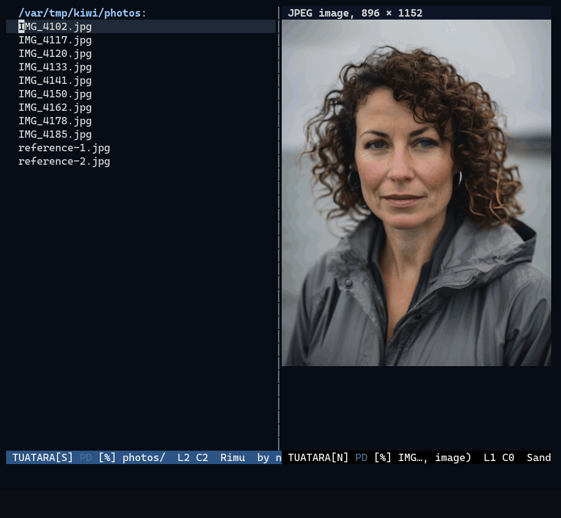

# facematch

Read the manual:
[tuatara-editor.github.io/tuatara-facematch](https://tuatara-editor.github.io/tuatara-facematch/).

Candidate photos ranked by how probable it is that they show the person of one
or more master photos, each with its probability and the ODNI's words for it.

The photos are chosen in rimu, with its preview showing each: master photos
marked `M`, candidates marked `>`. The comparison runs in the background, shut
in Tuatara's sandbox, by the facematch engine: InsightFace with the AuraFace-v1
model, in one AppImage. One of the Tuatara project's packages, not part of the
editor.

The manual says how to compare, what a probability means and where it should
not be trusted, how the photos are kept safe, and lists every command and
setting.

<picture>
  <source media="(prefers-color-scheme: light)" srcset="media/facematch-light.gif">
  
</picture>

## What it needs

- Tuatara 0.90.44 or later.
- The facematch engine, an AppImage (below). It is a project of its own,
  [github.com/YardQuit/facematch](https://github.com/YardQuit/facematch),
  where each release has `facematch-x86_64.AppImage` and its `SHA256SUMS`.
- On Arch and Omarchy, an AppImage needs FUSE 2 to run:
  `sudo pacman -S fuse2`.

The package never downloads the engine: what runs is the file you checked. The
engine's README says how to build it yourself instead.

## Installing it, step by step

1. **Get the engine.** Download the AppImage and its `SHA256SUMS`, check the one
   against the other, and keep the AppImage where you like:

   ```sh
   curl -LO https://github.com/YardQuit/facematch/releases/download/1.0.0/facematch-x86_64.AppImage
   curl -LO https://github.com/YardQuit/facematch/releases/download/1.0.0/SHA256SUMS
   sha256sum -c SHA256SUMS
   chmod +x facematch-x86_64.AppImage
   mkdir -p ~/Applications && mv facematch-x86_64.AppImage ~/Applications/
   ```

2. **Open your init file**: in Tuatara press `C-x C-f`, type
   `~/.config/tuatara/init.lisp` and press `RET`.
3. **Add these lines** to it, the path being where you put the engine:

   ```lisp
   (load-package "facematch" :source "https://github.com/Tuatara-Editor/tuatara-facematch"
     :config
     (setf *facematch-program* "~/Applications/facematch-x86_64.AppImage"))
   ```

4. **Save** with `C-x C-s`, **quit** with `C-x C-c`, and **start Tuatara
   again**. Answer `y` when it asks whether to load facematch; it asks once.
5. **Check it**: `M-x check-health` says whether the engine is found.

## On a machine without internet

Tuatara compiles the package itself, so only fetching it and the engine need
the internet. On a machine with internet, fetch the engine as in step 1, and:

```sh
git clone https://github.com/Tuatara-Editor/tuatara-facematch
git -C tuatara-facematch verify-tag "$(git -C tuatara-facematch describe --tags --abbrev=0)"
```

Copy the directory and the checked AppImage to the other machine, for instance
to `~/tuatara-packages/tuatara-facematch` and `~/Applications/`, and name the
directory in the init file:

```lisp
(load-package "facematch" :source "~/tuatara-packages/tuatara-facematch"
  :config
  (setf *facematch-program* "~/Applications/facematch-x86_64.AppImage"))
```

Carrying over the compiled files as well, so the other machine skips the
compiling, is in Tuatara's manual, chapter 19, "On a machine without
internet".

## Credits

- InsightFace (MIT): face alignment and the ArcFace runner.
- AuraFace-v1, by fal (Apache 2.0): the face recognition model.
- YuNet, from OpenCV Zoo (MIT): the face detector.
- Labeled Faces in the Wild, University of Massachusetts, Amherst: the
  calibration's photos.
- The Office of the Director of National Intelligence's ICD 203: the words of
  estimative probability.

## License

GPL-3.0-or-later; see `LICENSE` at the top of this repository. The models
keep their own licenses, carried in the AppImage.

## Working on it

```sh
tools/test.sh
```

runs its tests against a Tuatara source tree: `../tuatara` beside this
repository, or `../../tuatara` beside the directory it is in, unless
`TUATARA_SOURCE` names another. The tests mark and compare in rimu, by keys,
with a stand-in engine run through the real sandbox. How a package is laid out
and which of Tuatara's names it may use are in Tuatara's
[HACKING.org](https://github.com/Tuatara-Editor/tuatara/blob/main/HACKING.org);
bug reports, ideas and how changes are made in
[CONTRIBUTING.md](CONTRIBUTING.md). The manual's source is in `doc/manual/`;
`tools/manual-html.sh` in a Tuatara tree, given this repository's directory,
makes its pages.
